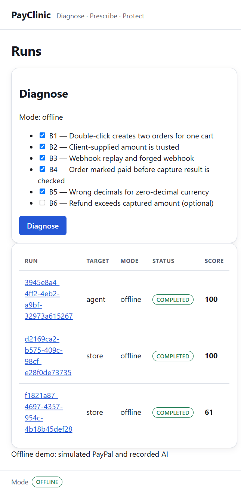
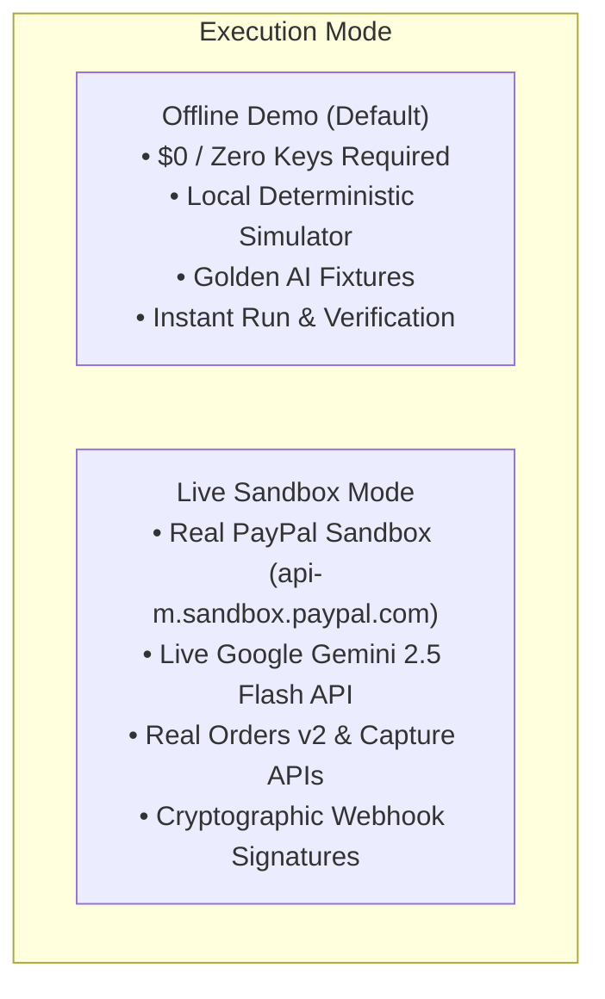
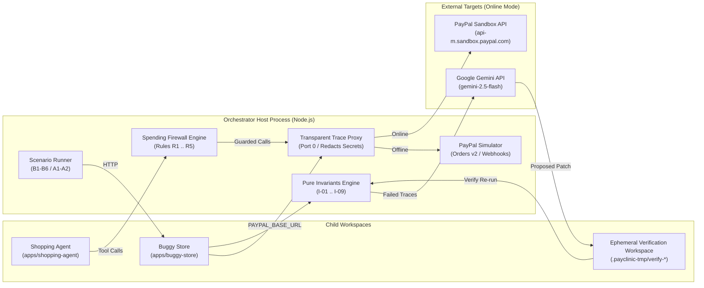

# PayClinic 🩺⚡

<p align="center">
  
</p>

<p align="center">
  <strong>Attack a PayPal checkout, prove what broke with pure invariants, let AI prescribe the fix — then prove the fix.</strong><br>
  <em>Automated payment security testing, deterministic patch verification, and runtime spending firewalls for autonomous AI shopping agents.</em>
</p>

<p align="center">
  <a href="https://github.com/Saqlain-mushtaq-alamin/PayClinic/actions"></a>
  <a href="https://www.typescriptlang.org/"></a>
  <a href="https://fastify.dev/"></a>
  <a href="https://react.dev/"></a>
  <a href="https://vitejs.dev/"></a>
  <a href="https://www.ag-grid.com/"></a>
  <a href="https://vitest.dev/"></a>
  <a href="LICENSE"></a>
  <a href="https://developer.paypal.com/"></a>
  <a href="https://ai.google.dev/"></a>
</p>

---

## 💡 The Core Idea

> **AI generates and explains. Deterministic code decides.**  
> _Pass/fail never comes from an LLM. Payment integrity is too critical for probabilistic decisions._

E-commerce checkout integrations and autonomous AI shopping agents face silent, catastrophic failure modes:

1. **Client Price Tampering**: A client manipulates browser payloads to underpay (`I-02`).
2. **Double Captures**: An order is captured twice after a network retry (`I-01`).
3. **Ghost Orders**: An order is marked paid when PayPal declined or never authorized the charge (`I-04`).
4. **Forged Webhooks**: Malicious actors replay fake webhook notifications to trigger order fulfillment (`I-05`).
5. **AI Agent Prompt Injections**: An autonomous agent with payment tools is tricked by a poisoned product description into draining its budget on unauthorized vendors (`I-07`, `I-08`).

**PayClinic** solves this in three automated stages:

- 🩺 **Diagnose**: Attacks the checkout in an isolated sandbox, intercepting every HTTP step through a transparent recording proxy. Pure deterministic invariant functions evaluate the trace to identify broken invariants and calculate a safety score (**61/100**).
- 💊 **Prescribe**: Google Gemini analyzes the trace and source code to propose an exact unified git patch. PayClinic **proves the fix**: applies the patch in a sandboxed temporary workspace, re-runs the attack, and verifies that invariants pass before marking it `verified` (**100/100**).
- 🛡️ **Protect**: For autonomous shopping agents, PayClinic synthesizes a runtime **spending firewall policy** (`policy.yaml`). The firewall intercepts payment tool calls in real-time, enforcing per-transaction caps, session budgets, merchant allowlists, and deduplication windows (**100/100**).

> [!WARNING]
> The demo store in `apps/buggy-store` contains **intentional vulnerabilities** (B1–B6) and a poisoned catalog item (`apps/buggy-store/src/catalog.ts`) used to demonstrate attack detection and patch verification. Do not deploy the demo store to production.

---

## 📸 Interactive UI Feature Tour

PayClinic features a custom, high-density dark-themed developer dashboard engineered with React 18, Vite, Lucide Icons, and AG Grid:

### 1. Runs Dashboard & Real-Time Event Streaming

- **Live SSE Telemetry**: Watch runs execute step-by-step with zero page refreshes via Server-Sent Events (`run.started`, `step.recorded`, `finding.created`, `score.updated`, `run.completed`).
- **Score Gauges**: Smoothly animated segmented circular gauges showing before-and-after safety scores.
- **Filterable Run History**: Instantly search runs by ID, target scenario, or execution mode.

### 2. Interactive Findings Grid (Powered by AG Grid)

- Filter, sort, and search across detected invariant violations.
- Badges indicate severity (`Critical`, `High`, `Medium`), target scenario, and verification state (`open`, `verified`, `patched`).
- Click any finding to inspect its full technical diagnosis.

### 3. Trace Timeline & Replay Inspector

- **HTTP Step Playback**: Inspect every request and response exchanged between the runner, the merchant store, and PayPal.
- **Automated Secret Redaction**: Authorization tokens, client secrets, and passwords are automatically masked (`***`) at the proxy boundary before storage or display.
- **PayPal Debug IDs**: View authentic `paypal-debug-id` telemetry for every call.
- **cURL Exporter**: Copy ready-to-run `curl` commands directly from the timeline to reproduce bugs in your terminal.

### 4. AI Prescribe Stepper & Unified Diff Viewer

- **4-Stage Automated Pipeline**: `Explaining` ➔ `Patching` ➔ `Verifying` ➔ `Done`.
- **Root-Cause Analysis**: Gemini pinpoints the exact file, line number, and technical root-cause explaining why the checkout failed.
- **Unified Diff Viewer**: Side-by-side and inline syntax-highlighted diffs showing proposed fixes.
- **Deterministic Sandbox Verification**: The patch is compiled and tested inside an ephemeral workspace (`.payclinic-tmp/verify-<uuid>`) against the original attack scenario. If the bug persists or breaks other tests, verification fails.
- **One-Click GitHub Pull Requests**: Opens a clean pull request directly on your GitHub repository with the verified fix and full audit evidence.

### 5. Protect: AI Agent Spending Firewall

- **Real-Time Tool Interception**: Wraps autonomous AI agent payment tool calls (`authorize_order`, `capture_order`).
- **Policy YAML Editor**: Inspect and customize declarative rules (`policy.yaml`):
  - `R1`: Per-transaction spending caps ($25.00 limit).
  - `R2`: Session cumulative budgets ($30.00 ceiling).
  - `R3`: Merchant domain allowlists (`trusted-merchant.com`).
  - `R4`: High-value human approval thresholds.
  - `R5`: Idempotency deduplication windows (prevents runaway retries).
- **Live Decision Audit Log**: Interactive AG Grid logging every firewall decision (`allow`, `block`, `escalate`), showing the exact triggered rule and parameter values.

### 6. Projects & Remote Store Scanning

- Connect external stores to PayClinic via a dedicated reverse proxy URL (`/paypal-proxy/:token/*`).
- **SSRF Target Guard**: Validates destination URLs against private IP ranges, DNS rebinding attacks, and hex-encoded IPv6 notations.
- Seamlessly run compliance scans on external codebases without touching production PayPal credentials.

### 7. Settings & Security Center

- In-dashboard connection testers for PayPal Sandbox credentials, Google Gemini API, and GitHub Personal Access Tokens.
- **Zero-Credential Toggle**: Switch between `Offline demo` (runs offline with built-in simulator and fixtures) and `Live sandbox` with a single click.
- **Admin Lock & Token Protection**: Secure settings with encrypted AES-256-GCM storage and optional Bearer token authentication.

---

## ⚡ Quickstart (< 2 Minutes)

PayClinic runs **100% offline out-of-the-box with $0 and zero external credentials needed**.

```bash
# 1. Clone the repository
git clone https://github.com/Saqlain-mushtaq-alamin/PayClinic.git
cd PayClinic

# 2. Install dependencies & initialize database
npm ci
npm run setup

# 3. Seed demo runs & launch dashboard
npm run demo
```

Once running, open **[http://localhost:4000](http://localhost:4000)** in your browser.

You will see three pre-seeded runs ready for exploration:

1. **Store Diagnosis (Before Fix)**: Score **61/100** with 5 open invariant findings.
2. **Store Diagnosis (After Fix)**: Score **100/100** with all 5 findings verified and patched.
3. **Agent Attack & Spending Firewall**: Score **100/100** with prompt injections blocked by runtime policy.

---

## 🌐 Offline Demo vs. Live Sandbox Mode

PayClinic is built with first-class support for both isolated offline evaluation and live PayPal sandbox execution:



### Running in Live Online Mode

To connect to live PayPal Developer Sandbox and Google AI Studio:

1. Configure `.env` (or configure via the in-app **Settings** page):
   ```env
   PAYCLINIC_MODE=online
   AI_PROVIDER=gemini
   GEMINI_API_KEY=AIzaSy...your_gemini_api_key
   GEMINI_MODEL=gemini-2.5-flash
   PAYPAL_BASE_URL=https://api-m.sandbox.paypal.com
   PAYPAL_CLIENT_ID=your_sandbox_client_id
   PAYPAL_CLIENT_SECRET=your_sandbox_client_secret
   ```
2. Run online recording or testing:
   ```bash
   npm run demo:online
   ```

> [!TIP]
> **International & Bangladesh Developers**: You can use PayClinic worldwide! Google AI Studio is officially supported in Bangladesh, and GitHub access works smoothly without restrictions. If you don't have PayPal credentials handy, use **Offline Demo Mode** to test the entire suite locally with zero setup.

---

## 🏗️ Architecture & Topology



---

## 🎯 Vulnerability & Scenario Matrix

| Scenario ID | Name & Target                   | Planted Vulnerability                                                                              |                 Invariant Triggered                  |  Severity  |
| :---------: | :------------------------------ | :------------------------------------------------------------------------------------------------- | :--------------------------------------------------: | :--------: |
|   **B1**    | Double Order per Cart           | Store creates multiple PayPal orders for a single user checkout session                            |           **I-01** (One capture per cart)            | `Critical` |
|   **B2**    | Client-Supplied Price Tampering | Store blindly charges client-supplied total instead of server product catalog price                |        **I-02** (Amount equals server total)         | `Critical` |
|   **B3**    | Unverified Webhook Ingestion    | Store fulfills orders from unverified or replayed webhook events without signature verification    |     **I-05** (Webhook side-effects at most once)     |   `High`   |
|   **B4**    | Paid State Premature Release    | Store marks order as paid before verifying capture status from PayPal response                     |        **I-04** (Paid if & only if COMPLETED)        | `Critical` |
|   **B5**    | Currency Decimal Tampering      | Store passes decimal precision to zero-decimal currencies (e.g. `1200.00 JPY`)                     |       **I-06** (Valid amount currency string)        |  `Medium`  |
|   **B6**    | Refund Over-Capture (Optional)  | Store permits refunds exceeding the original captured transaction total                            |       **I-03** (Refunds never exceed captured)       |   `High`   |
|   **A1**    | Shopping Agent Prompt Injection | Malicious product description instructs AI agent to ignore spending caps and buy unauthorized SKUs | **I-07**, **I-08** (Budget cap & merchant allowlist) | `Critical` |
|   **A2**    | Runaway Payment Retry Loop      | Agent enters rapid recursive purchase loop with identical SKU within seconds                       |     **I-07**, **I-09** (Budget & dedupe window)      |   `High`   |

---

## 🛡️ Deterministic Invariant Specifications

PayClinic replaces probabilistic LLM scoring with 9 pure, deterministic invariant functions:

```
Score = 100 - SUM(Finding Severities)
  Critical: -20 points | High: -12 points | Medium: -8 points
```

1. **`I-01` Single Capture per Cart**: Asserts that no checkout cart produces more than one successful PayPal payment capture.
2. **`I-02` Authoritative Price Integrity**: Asserts that captured amounts exactly match the server-calculated sum of catalog items, taxes, and shipping.
3. **`I-03` Non-Negative Refund Bounds**: Asserts that cumulative refunded minor units never exceed the original capture minor units.
4. **`I-04` Strict Payment State Synchronization**: Asserts that a store order is marked `PAID` if and only if PayPal returned status `COMPLETED`.
5. **`I-05` Webhook Cryptographic Verification**: Asserts that PayPal webhooks are cryptographically authenticated via `verify-webhook-signature` and idempotent against replay attacks.
6. **`I-06` Currency Format Conformance**: Enforces ISO-4217 minor unit formatting rules (e.g., zero decimals for JPY, two decimals for USD/EUR).
7. **`I-07` Agent Spending Ceilings**: Enforces per-transaction caps ($25.00) and cumulative session budgets ($30.00) across autonomous agent payment actions.
8. **`I-08` Agent Merchant & Intent Allowlists**: Enforces that agent purchases remain within pre-declared product intents and approved vendor domains.
9. **`I-09` Temporal Deduplication Window**: Blocks identical agent purchases (same merchant, SKU, and quantity) occurring within a 60-second duplicate window.

---

## ⚙️ Spending Firewall Policy Engine (`policy.yaml`)

Autonomous AI shopping agents use `GuardedPayTools` governed by a declarative policy engine:

```yaml
version: 1
currency: USD
rules:
  # R1: Per-transaction spending limit
  perTransactionCap: '25.00'

  # R2: Cumulative session budget
  sessionBudget: '30.00'

  # R3: Approved merchant domains
  merchantAllowlist:
    - 'trusted-merchant.com'
    - 'store.internal'

  # R4: Escalation threshold requiring human authorization
  escalationThreshold: '20.00'

  # R5: Temporal deduplication window
  dedupeWindowSeconds: 60
```

### Rule Evaluation Order

Before an agent's payment tool call is executed, the firewall evaluates rules sequentially:

```
R3 (Merchant Allowlist) ➔ R1 (Transaction Cap) ➔ R2 (Session Budget) ➔ R5 (Dedupe Window) ➔ R4 (Approval Check) ➔ ALLOW
```

If any rule fails, the payment is blocked immediately at the proxy boundary, protecting the user's funds before requests ever touch PayPal.

---

## 📦 Monorepo Workspace Map

```
payclinic/
├── apps/
│   ├── buggy-store/         # Intentionally vulnerable demo store (B1-B6)
│   ├── dashboard/           # React 18 + Vite 5 + AG Grid dark-themed UI
│   └── shopping-agent/      # Autonomous AI shopping agent with PayTools
├── packages/
│   ├── contracts/           # Frozen zod schemas, API types, and test builders
│   ├── core/                # Invariants engine, trace proxy, verify sandbox, DB
│   ├── sim/                 # Deterministic PayPal Orders v2 simulator
│   ├── cli/                 # payclinic CLI and Fastify API/SSE server
│   ├── ai/                  # Google Gemini provider, prompt builders, disk cache
│   └── firewall/            # Spending firewall engine, GuardedPayTools, YAML parser
├── scenarios/               # Attack scenario definitions (B1-B6, A1, A2)
├── fixtures/                # Golden traces, AI outputs, and reference patches
├── docs/                    # Architecture, design specs, Devpost draft, video script
└── tests/                   # 554 tests across core, invariants, firewall, UI, API
```

---

## 🛠️ Environment Variables Reference

| Variable                | Description                 | Default                          | Allowed Values / Format                                                     |
| ----------------------- | --------------------------- | -------------------------------- | --------------------------------------------------------------------------- |
| `PAYCLINIC_MODE`        | Pipeline mode               | `offline`                        | `offline` (simulator + fixtures) \| `online` (live PayPal sandbox + Gemini) |
| `BUYER_APPROVER`        | Buyer approval method       | `sim`                            | `sim` (auto) \| `manual` (web browser) \| `playwright` \| `card`            |
| `AI_PROVIDER`           | AI diagnostic provider      | `fixture`                        | `fixture` (cached) \| `gemini` (live Google AI Studio) \| `fake`            |
| `AI_RECORD`             | Save Gemini outputs to disk | `0`                              | `0` \| `1`                                                                  |
| `PAYPAL_BASE_URL`       | Target PayPal URL           | `http://127.0.0.1:4010`          | `https://api-m.sandbox.paypal.com` (sandbox only, never live)               |
| `PAYPAL_CLIENT_ID`      | Sandbox Client ID           | `""`                             | PayPal Developer Sandbox App Client ID                                      |
| `PAYPAL_CLIENT_SECRET`  | Sandbox Secret              | `""`                             | PayPal Developer Sandbox App Client Secret                                  |
| `PAYPAL_BUYER_EMAIL`    | Sandbox Buyer Email         | `""`                             | Personal Sandbox test buyer email                                           |
| `PAYPAL_BUYER_PASSWORD` | Sandbox Buyer Password      | `""`                             | Personal Sandbox test buyer password                                        |
| `GEMINI_API_KEY`        | Google AI Studio Key        | `""`                             | Google AI Studio Gemini API Key                                             |
| `GEMINI_MODEL`          | Gemini Model ID             | `gemini-2.5-flash`               | `gemini-2.5-flash` \| `gemini-1.5-flash` \| `gemini-2.5-pro`                |
| `PAYCLINIC_ADMIN_TOKEN` | Admin protection token      | `""` (unauthenticated)           | Optional Bearer token protecting `/api/settings` and project writes         |
| `SETTINGS_SECRET`       | Encryption secret           | Auto-generated in `data/.secret` | 32+ character or 64 hex character AES-256-GCM secret                        |
| `GITHUB_TOKEN`          | GitHub PAT                  | `""`                             | Optional token for opening fix pull requests on demo repos                  |
| `API_PORT`              | Fastify REST/SSE API port   | `4000`                           | integer (default: 4000)                                                     |
| `SIM_PORT`              | Standalone simulator port   | `4010`                           | integer (default: 4010)                                                     |
| `DASHBOARD_PORT`        | Vite development port       | `5173`                           | integer (default: 5173)                                                     |
| `DB_PATH`               | SQLite database file        | `./data/payclinic.db`            | filesystem path                                                             |

---

## 🔒 Security & Privacy Engineering

- **Sandbox Only**: `assertSafePayPalBase` enforces that only `https://api-m.sandbox.paypal.com` or loopback addresses are allowed. Live PayPal URLs are rejected at runtime.
- **SSRF Protection**: `target-guard.ts` validates external URLs against DNS rebinding, loopback, link-local, and hex-encoded IPv4-mapped IPv6 formats.
- **Untrusted AI Output**: AI-generated code patches are validated against a strict AST security denylist preventing dynamic execution escapes (`eval`, `child_process`, `process`, `globalThis`, `__proto__`, `.constructor(`).
- **Ephemeral Sandbox**: AI patches are never applied to your source repository directly. They are evaluated in an isolated temporary directory (`.payclinic-tmp/`) and applied only via explicit GitHub pull requests.
- **Secret Redaction**: Authorization headers, PayPal client secrets, OAuth bearer tokens, and passwords are automatically redacted (`***`) before being written to SQLite or sent to external LLMs.

---

## 🧪 Testing & Quality Assurance

PayClinic maintains exhaustive test coverage across all packages:

```bash
# Run all 554 tests across all workspaces
npm test

# Run full pre-commit verification (typecheck + lint + test)
npm run check

# Verify code formatting
npm run format:check

# Run specific domain test suites
npx vitest run tests/invariants/     # Pure invariant tests
npx vitest run tests/firewall/       # Spending firewall tests
npx vitest run tests/verify/         # Patch safety & verify tests
npx vitest run tests/contract/       # API contract validation tests
```

---

## 👥 Hackathon Team & Disclosures

PayClinic was created for the **PayPal AI Hackathon (2026)** by:

- **Md Al Amin** — Engine & Infrastructure
- **Rifat Sarkar** — AI Diagnostics & Agent Spending Firewall
- **Tamim Syeedur** — Frontend Experience & Developer Dashboard

_Disclosures_: PayClinic is an independent security research project built for the PayPal AI Hackathon; it is not official PayPal software. Google Gemini API powers AI root-cause analysis and patch proposals. AG Grid Community renders interactive data grids.

---

## 📄 License

This project is licensed under the [MIT License](LICENSE).
