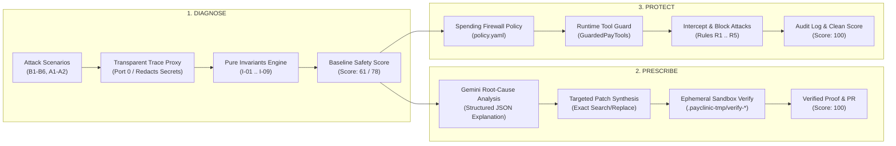
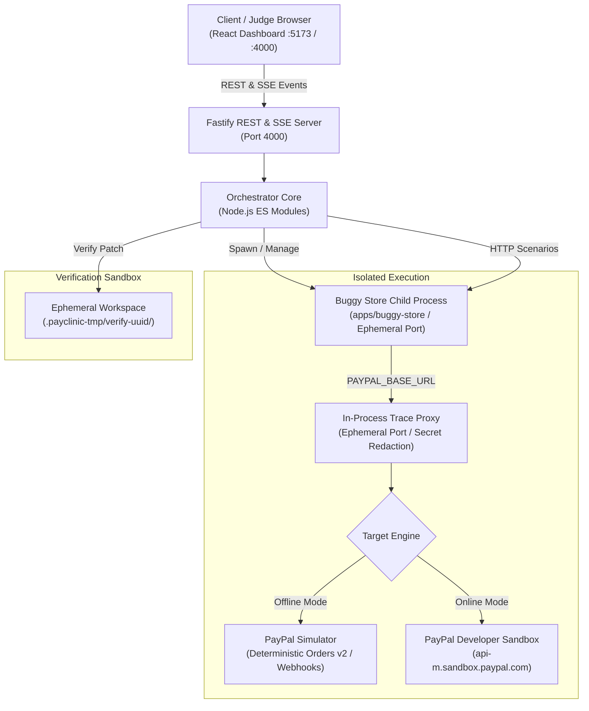
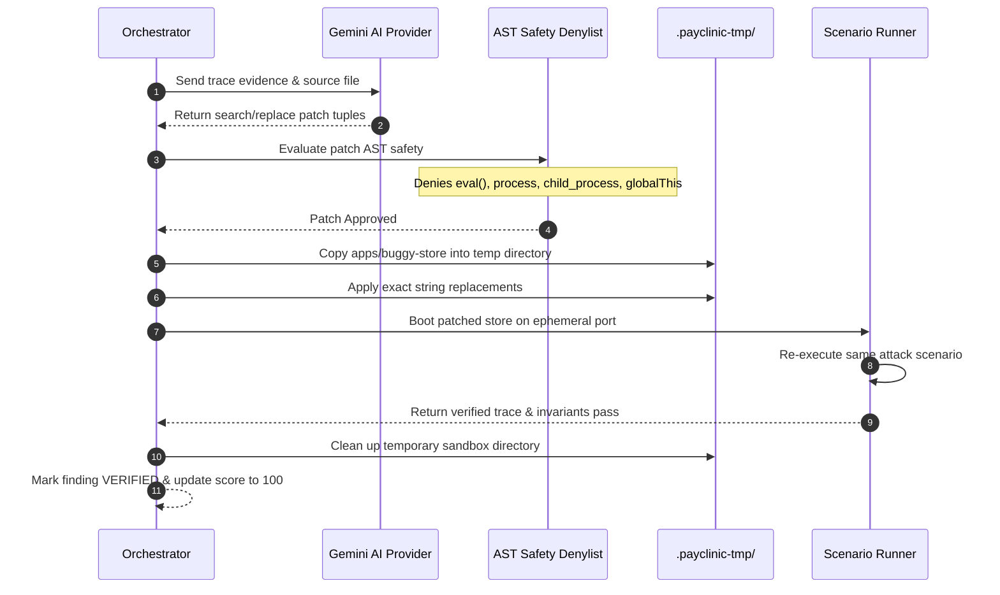
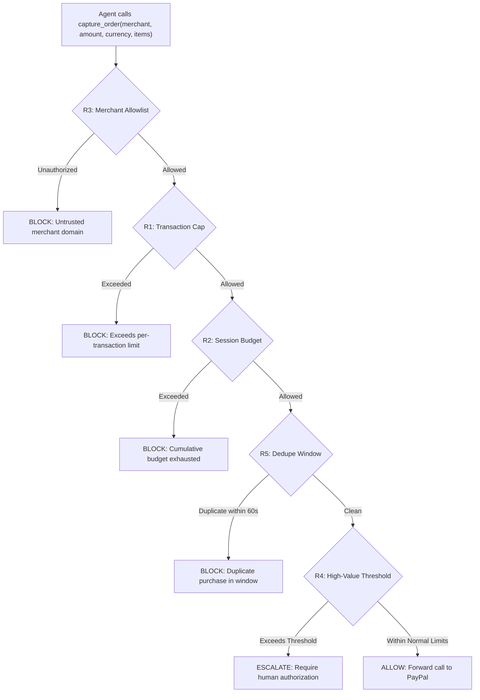

# PayClinic System Architecture 🩺⚡

> **Pure Invariant Verification, Transparent Trace Proxies, and Autonomous Agent Spending Firewalls.**  
> _The architectural blueprint for the PayClinic payment-safety scanner._

---

## 🏛️ Core Design Principles

1. **AI Generates and Explains. Deterministic Code Decides.**  
   Pass/fail status, security scores, and invariant checks never come from an LLM. Invariants are pure mathematical functions that evaluate immutable HTTP traces.
2. **Prove the Fix Before Trusting It.**  
   An AI-generated patch is untrusted code. It is compiled and executed exclusively inside an ephemeral sandbox against the original attack scenario. Only when deterministic code confirms the invariant passes is a patch marked `verified`.
3. **Defense in Depth for Autonomous Agents.**  
   AI shopping agents are protected by a deterministic spending firewall (`policy.yaml`) that wraps payment tools and evaluates allowlists, caps, budgets, and deduplication windows before tool calls can reach the network.
4. **Zero-Live-Secret Boundary.**  
   Live PayPal credentials and hostnames are banned by runtime guards (`assertSafePayPalBase`). All traces, payloads, and logs automatically redact credentials and authorization tokens at the proxy boundary.

---

## 🔄 The Three-Stage Architecture



---

## 🖥️ Process & Networking Topology

PayClinic runs as a coordinated single-process orchestrator managing ephemeral child processes:



### Key Architectural Traits:

- **Ephemeral Port Binding (Port 0)**: Child processes (store, simulator, proxy) are allocated random OS ports during execution to eliminate port collisions and permit concurrent testing.
- **Process Cleanup Guarantees**: All child processes and HTTP listener sockets are cleaned up inside robust `finally` blocks (`SIGTERM` followed by `SIGKILL` on timeout).
- **In-Memory Trace Proxy**: Intercepts HTTP traffic between the merchant store and PayPal, capturing request/response bodies, status codes, timestamps, and PayPal debug IDs into SQLite.

---

## 📦 Monorepo Workspace Architecture

```
packages/
├── contracts/          # Shared zod schemas, TypeScript types, and test builders
├── core/               # Orchestrator, runner, trace proxy, invariants, verify sandbox
├── sim/                # Pure deterministic PayPal simulator (Orders v2, Webhooks, Mock Responses)
├── cli/                # payclinic CLI entry point, Fastify API server, static UI host
├── ai/                 # Gemini API integration, prompt templates, fixture cache
└── firewall/           # Spending firewall engine, GuardedPayTools, YAML policy validator

apps/
├── buggy-store/        # Planted vulnerability demo store (B1-B6)
├── shopping-agent/     # Autonomous AI agent loop with PayTools & prompt injection harnesses
└── dashboard/          # React 18 + Vite 5 + AG Grid dark-themed developer UI

scenarios/              # Deterministic attack scenarios (B1-B6, A1, A2)
fixtures/               # Golden trace captures, AI explanation fixtures, reference diffs
```

---

## 🔬 Deterministic Invariant Engine (`packages/core/src/invariants`)

PayClinic evaluates 9 pure invariant functions against the recorded trace:

```typescript
export interface InvariantResult {
  passed: boolean;
  severity?: 'critical' | 'high' | 'medium';
  finding?: InvariantFinding;
}

export type InvariantFn = (trace: TraceRecord) => InvariantResult;
```

### Invariant Catalog:

- **`I-01` Single Capture per Cart (`critical`, -20 pts)**: Ensures that for any shopping cart session, at most one successful `orders/:id/capture` occurs.
- **`I-02` Authoritative Price Integrity (`critical`, -20 pts)**: Verifies that the captured order amount equals the server-calculated sum of catalog items, preventing client price tampering.
- **`I-03` Non-Negative Refund Bounds (`high`, -12 pts)**: Verifies that cumulative refunded amounts never exceed captured amounts (`refundedTotal <= capturedTotal`).
- **`I-04` Strict Payment State Synchronization (`critical`, -20 pts)**: Ensures a store order is marked `PAID` if and only if PayPal returned `status === 'COMPLETED'`.
- **`I-05` Webhook Cryptographic Verification (`high`, -12 pts)**: Rejects forged webhooks and duplicate webhook replay deliveries.
- **`I-06` Currency Conformance (`medium`, -8 pts)**: Rejects decimal amounts for zero-decimal currencies (JPY) and malformed ISO-4217 strings.
- **`I-07` Agent Spending Ceilings (`high`, -12 pts)**: Enforces per-transaction caps and session budgets on agent tool actions.
- **`I-08` Agent Intent & Merchant Allowlists (`critical`, -20 pts)**: Enforces that agent tool calls stay within allowed merchant domains and declared product items.
- **`I-09` Temporal Deduplication Window (`high`, -12 pts)**: Blocks duplicate agent purchases of the same SKU within a 60-second window.

---

## 🧪 Ephemeral Sandbox Verification Pipeline (`packages/core/src/verify`)

When Gemini prescribes a code patch, PayClinic subjects the fix to rigorous verification:



---

## 🛡️ Autonomous Agent Spending Firewall (`packages/firewall`)

For AI shopping agents, PayClinic intercepts payment tool calls at runtime using a declarative spending firewall policy:



---

## 🔒 Security & SSRF Target Guard

PayClinic includes enterprise-grade guardrails for remote project scanning:

1. **DNS Pinning & Private IP Blocking**:
   `packages/core/src/runner/target-guard.ts` resolves remote domains and denies requests to:
   - Loopback (`127.0.0.0/8`, `::1`)
   - Private subnets (`10.0.0.0/8`, `172.16.0.0/12`, `192.168.0.0/16`)
   - Cloud metadata endpoints (`169.254.169.254`)
   - IPv4-mapped IPv6 hex addresses (`::ffff:7f00:1`, `::ffff:a9fe:a9fe`)
2. **Redirect Control**: Recorded HTTP clients use `redirect: 'manual'` to prevent open-redirect SSRF evasions.
3. **Encrypted Storage**: Sensitive settings are encrypted at rest with AES-256-GCM using keys stored in `data/.secret`.
4. **Header Redaction**: `SECRET_HEADERS` filters out `authorization`, `paypal-auth-assertion`, `x-payclinic-admin`, and API keys before traces reach SQLite or external LLMs.
